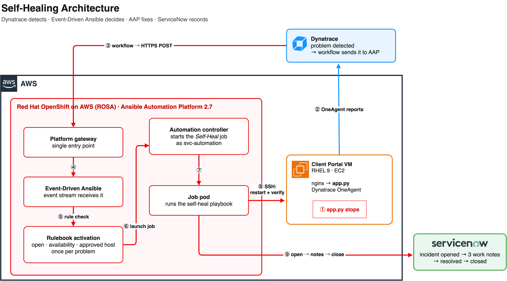

# Self-Healing with Dynatrace, Event-Driven Ansible and ServiceNow

Closed-loop remediation for a routine service outage. **Dynatrace** detects the failure,
**Event-Driven Ansible** decides whether it is safe to act, the **automation controller** fixes
and verifies the server, and **ServiceNow** records every step, from incident opened to incident
closed, with no human involved.

Measured on this setup, for a stopped service: **about 70 seconds** from outage to fixed,
verified and documented.



---

## How it works

| # | Step | Component |
|---|---|---|
| ① | The application process (`app.py`) on the VM stops | RHEL 9 VM |
| ② | Dynatrace OneAgent reports it, and a process availability rule opens a problem | Dynatrace |
| ③ | A Dynatrace **Workflow** sends the problem to AAP (HTTPS POST to an EDA event stream) | Dynatrace → AAP |
| ④ | The platform gateway passes it to the **Event-Driven Ansible** event stream | AAP |
| ⑤ | The **rulebook** checks it: open + availability + approved host, once per problem | EDA |
| ⑥ | The rule launches the job template *Self-Heal :: Service Recovery*, as a service account | EDA → controller |
| ⑦ | A job pod runs `playbooks/selfheal_service.yml` | Automation controller |
| ⑧ | The job connects to the VM over SSH: captures diagnostics, restarts the service, verifies `/health` | VM |
| ⑨ | The job opens the incident **before** changing anything, adds three work notes (diagnostics, implementation, verification), then resolves and closes it | ServiceNow |

If verification fails, the incident is **escalated to the Service Desk and left open**, and the
job fails.

---

## Components

| Component | Used here |
|---|---|
| Ansible Automation Platform | 2.7, installed with the AAP operator on **Red Hat OpenShift Service on AWS (ROSA)**: platform gateway, automation controller, Event-Driven Ansible |
| Demo workload | RHEL 9 VM (EC2) in the ROSA VPC: nginx → `app.py` (systemd service `demo-api`), shown as the "Client Portal" |
| Dynatrace | SaaS, OneAgent in full-stack mode, process availability rule, Workflows |
| ServiceNow | Incident table through the REST API, using the certified `servicenow.itsm` collection |

---

## Repository layout

| Path | Purpose |
|---|---|
| `playbooks/prepare_demo_app.yml` | Builds the demo workload on the VM. Safe to re-run: restores the healthy state. |
| `playbooks/break_service.yml` | Fault injection: stops `demo-api` (`scenario=service`) or fills the disk (`scenario=disk`) |
| `playbooks/install_oneagent.yml` | Installs Dynatrace OneAgent, full-stack, host group `demo-selfhealing` |
| `playbooks/selfheal_service.yml` | The remediation playbook: incident, diagnostics, restart, verification, resolve and close, or escalate |
| `extensions/eda/rulebooks/dynatrace-selfheal.yml` | EDA rulebook: conditions, throttle, job template launch |
| `collections/requirements.yml` | Collections installed by the controller on project sync |
| `dynatrace/workflow-http-action.json` | Request body for the Dynatrace Workflow HTTP task (maps the problem record to the fields the rulebook reads) |
| `openshift/` | Namespace, operator subscription and `AnsibleAutomationPlatform` resource |
| `scripts/install-aap-operator.sh` | Installs the AAP operator and instance on OpenShift |
| `scripts/create-demo-vm.sh` / `delete-demo-vm.sh` | Creates / removes the demo VM in the ROSA cluster's VPC |
| `scripts/send-fake-dynatrace-problem.sh` | Sends a Dynatrace-style alert to the EDA event stream, for testing EDA without Dynatrace |
| `scripts/status.sh` | Quick health check of all components |
| `demo.env.example` | Template for the local settings file used by the scripts (`demo.env` is git-ignored) |

---

## Setup overview

### 1. Infrastructure

1. An OpenShift cluster on AWS (ROSA) with cluster-admin access, and the `aws` and `oc` CLIs.
2. Create the demo VM inside the cluster's VPC, so AAP job pods can reach it over its private IP:
   ```bash
   cp demo.env.example demo.env   # fill in your values
   source demo.env
   ./scripts/create-demo-vm.sh
   ```
3. Install AAP:
   ```bash
   ./scripts/install-aap-operator.sh
   ```
   Then log in and add your subscription.

### 2. Automation controller

| Object | Settings |
|---|---|
| Credential types | `ServiceNow PDI` (injects `SN_HOST`, `SN_USERNAME`, `SN_PASSWORD`), `Dynatrace API` (injects `DT_TENANT_URL`, `DT_API_TOKEN`, `DT_PAAS_TOKEN`) |
| Credentials | Machine credential for the VM (`ec2-user`, SSH key, sudo), plus one of each custom type |
| Project | This Git repository |
| Inventory | Group `demo_app`, host `app01` with `ansible_host: <VM private IP>` |
| Job templates | `Demo :: Prepare app`, `Chaos :: Inject fault` (survey `scenario`), `Demo :: Install OneAgent`, **`Self-Heal :: Service Recovery`** (*Prompt on launch* for variables, extra variable `aap_url`) |
| Service account | A normal user with only *Execute* on the Self-Heal job template. EDA launches the job as this user. |

### 3. Event-Driven Ansible

| Object | Settings |
|---|---|
| Project | This Git repository (rulebook in `extensions/eda/rulebooks/`) |
| Decision environment | `registry.redhat.io/ansible-automation-platform-27/de-supported-rhel9:latest` |
| Credential | *Red Hat Ansible Automation Platform* type, URL `https://<aap-host>/api/controller/`, the service account |
| Event stream | Type *Dynatrace Event Stream* (username/password), forwarding on |
| Rulebook activation | Rulebook `dynatrace-selfheal.yml`, source `dynatrace_problems` mapped to the event stream |

### 4. ServiceNow

- An integration user with the **`itil`** role, used by the playbook through the REST API.
- On recent ServiceNow releases, set the user's **Identity type to Machine**. With *Human*, API
  logins with a username and password were rejected (HTTP 401).
- Incidents are resolved and closed with the resolution code **`Solution provided`**. Older codes
  such as `Solved (Permanently)` are rejected on recent releases.

### 5. Dynatrace

1. Install OneAgent with the `Demo :: Install OneAgent` job template. It puts the host in host group
   `demo-selfhealing`.
2. Add a **process availability** rule for the application process: command line
   `$contains(/opt/demo-api/app.py)`.
3. Add the AAP host name to **Settings → General → External requests**.
4. Store the event stream username and password in the **credential vault**.
5. Create a **Workflow**:
   - **Problem trigger:** event state *active*, category *Availability*, custom filter `matchesValue(dt.host_group.id, "demo-selfhealing")`, *Wait for root cause analysis* off
   - **HTTP request task:** POST to the event stream URL, authenticated from the credential vault, payload from `dynatrace/workflow-http-action.json`
6. In **Workflows → Settings → Authorization settings**, grant the workflow permissions
   (at least `app-engine:apps:run`, `app-engine:functions:run`, `app-settings:objects:read`).

---

## Running it

```bash
# 1. Make sure everything is healthy and no Dynatrace problem is open for the VM
./scripts/status.sh

# 2. Break the service: launch the "Chaos :: Inject fault" job template (scenario: service)

# 3. Watch, without touching anything:
#    Dynatrace Problems → EDA Rule Audit → AAP Jobs → ServiceNow incident → application healthy
```

To test the AAP and ServiceNow part without Dynatrace:

```bash
./scripts/send-fake-dynatrace-problem.sh
PROBLEM_ID=demo-1 ./scripts/send-fake-dynatrace-problem.sh   # send twice: only one fix (throttle)
TAGS="env:demo" ./scripts/send-fake-dynatrace-problem.sh     # host not approved: no fix
STATE=RESOLVED ./scripts/send-fake-dynatrace-problem.sh      # resolution message: logged only
```

---

## Guardrails

| Guardrail | Where it is enforced |
|---|---|
| Only open availability problems | Dynatrace workflow trigger + rulebook condition |
| Only approved hosts | Host group `demo-selfhealing` (workflow filter + rulebook tag check) |
| One fix per problem | Rulebook `throttle` (once per problem per 10 minutes) |
| Only approved services | `allowed_services` + `assert` in the playbook |
| Evidence before action | Diagnostics captured and written to the incident before the restart |
| Verify, don't assume | HTTP 200 **and** `"status": "ok"` from `/health`, up to 10 attempts |
| Fail loudly | Failed verification escalates the incident (never closes it) and fails the job |
| Least privilege | EDA runs as a user that can launch one job only; secrets in AAP credentials and the Dynatrace credential vault |

---

## Notes and limitations

- **Single host, single failure type.** The target host and service are fixed in the rulebook.
  In production, map the Dynatrace entity to the inventory host and add one playbook per
  problem type.
- **Approval by host group.** On the Dynatrace platform used here, host tags set with
  `oneagentctl` are not copied into problem records, so the host group is used as the approval
  marker. Dynatrace primary tags could replace it.
- **Workflows instead of problem notifications.** New Dynatrace environments no longer offer
  classic problem notifications and alerting profiles; a Workflow sends the problem to EDA.
- **Comments back to Dynatrace** are implemented in the playbook but need a Dynatrace API token
  with problem write access, which was not available in the environment used here. They are
  skipped without affecting the remediation.
- **Single managed host.** The playbook runs on the target host and delegates the API calls to
  the execution environment, so only the target host counts against the AAP subscription.
